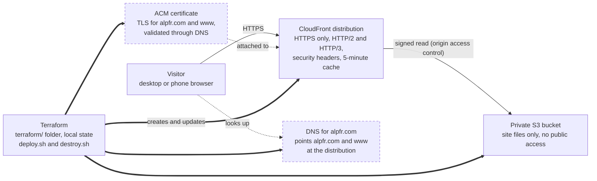

# alpfr.com: architecture

alpfr.com is a single static page served from a private S3 bucket through CloudFront, with all
infrastructure defined in Terraform. Nothing has been deployed yet, and the Terraform has not been
run or validated.

## Design decisions

| Decision | Choice | Reason |
| --- | --- | --- |
| Site type | One static HTML page plus a capabilities PDF | No server to run, patch or pay for |
| Hosting | S3 origin behind CloudFront | Near-zero cost, HTTPS and a CDN included |
| Bucket access | Private, readable only by the distribution | No public bucket to misconfigure |
| Infrastructure as code | Terraform, local state | Repeatable and reviewable |
| Rollout | Preview URL first, DNS cutover second | The live site is untouched until the new one is approved |
| Contact form | Opens the visitor's email app | Keeps the site fully static; a backend can be added later |
| Networking | No VPC | S3 and CloudFront are AWS-managed services outside any VPC; the site runs no servers |

## Diagram

Dashed boxes are added at cutover (stage 2).

A visitor's browser looks up alpfr.com in DNS and connects to CloudFront over HTTPS. CloudFront reads
the page from the bucket with a signed request, and the bucket refuses everyone else. The preview
stage uses only the visitor, CloudFront and S3, on a `cloudfront.net` address.

## Components

Terraform creates seven resources of six kinds for the preview and adds up to three kinds more at
cutover. Everything is in us-east-1, because CloudFront only accepts certificates from that region.

| Component | Terraform resource | Role | Created |
| --- | --- | --- | --- |
| Site bucket | `aws_s3_bucket.site` | Stores the site files; named `alpfr-com-site-<account id>` | Stage 1 |
| Public access block | `aws_s3_bucket_public_access_block.site` | Blocks every form of public access | Stage 1 |
| Site files | `aws_s3_object.site` | Uploads `index.html` and the PDF with a 5-minute cache lifetime | Stage 1 |
| Origin access control | `aws_cloudfront_origin_access_control.site` | Lets CloudFront sign its requests to S3 | Stage 1 |
| Distribution | `aws_cloudfront_distribution.site` | Serves the site over HTTPS with compression | Stage 1 |
| Bucket policy | `aws_s3_bucket_policy.site` | Allows `s3:GetObject` only to this one distribution | Stage 1 |
| Certificate | `aws_acm_certificate.site` | TLS certificate for `alpfr.com` and `www.alpfr.com` | Stage 2 |
| Validation records | `aws_route53_record.cert_validation` | Proves domain ownership to ACM | Stage 2, Route 53 only |
| Site DNS records | `aws_route53_record.site` | A and AAAA aliases for both hostnames | Stage 2, Route 53 only |

Two AWS-managed policies are attached to the distribution: `Managed-CachingOptimized` and
`Managed-SecurityHeadersPolicy`. Two variables control the rollout: `enable_custom_domain`
(default `false`) and `route53_zone_id` (default empty).

## Security

- **Origin protection:** all four S3 public-access blocks are on. The bucket policy grants read access
  to the CloudFront service only when the request comes from this distribution's ARN.
- **Transport:** HTTP is redirected to HTTPS. With the custom domain, the minimum protocol is TLS 1.2
  (`TLSv1.2_2021`) with SNI.
- **Response headers:** the managed security headers policy adds HSTS, `X-Content-Type-Options`,
  `X-Frame-Options`, a referrer policy and XSS protection.
- **Methods:** only GET and HEAD are allowed. The site accepts no uploads or form posts.
- **No secrets or personal data:** nothing is stored server-side. The contact form hands off to the
  visitor's own email app.

Not included yet: a web application firewall (it comes with the CloudFront flat-rate Free plan once
that plan is selected), access logging, and a Content-Security-Policy header. The page loads fonts
from Google Fonts, which a CSP would need to allow.

## Cost

Expected cost is about $0 a month at brochure-site traffic.

| Item | Cost | Notes |
| --- | --- | --- |
| CloudFront, flat-rate Free plan | $0/month, no overages | 1M requests and 100 GB a month; includes WAF, DDoS protection and DNS. Selected in the console after the distribution exists. |
| S3 storage | Cents | The site is about 110 KB |
| ACM certificate | $0 | Public certificates used with CloudFront are free |
| Route 53 hosted zone | About $0.50/month | Only if DNS is in Route 53 and not covered by the plan; not verified |

Terraform creates the distribution as pay-as-you-go. Whether the provider can select the flat-rate
plan directly was not confirmed.

Sources: [AWS flat-rate pricing announcement](https://aws.amazon.com/blogs/networking-and-content-delivery/introducing-flat-rate-pricing-plans-with-no-overages),
[AWS Free Tier for web apps](https://aws.amazon.com/free/webapps).

## Pre-launch checklist

- [ ] Company spelling: ALPFR (domain and page) or ALPHR (capability statement and its PDF)
- [ ] Which of the six applications to show publicly, and whether any should link out
- [ ] UEI and CAGE code
- [ ] NAICS codes (541512, 541511, 541519 and 518210 are suggestions only)
- [ ] Business type and small business certifications or set-asides
- [ ] Certifications beyond CISSP
- [ ] AWS partner status: confirm the tier or remove the line
- [ ] Personnel clearances: add them or remove the line
- [ ] Contact inbox: `info@alpfr.com` is a placeholder in the page script
- [ ] Run `./deploy.sh --plan`; the configuration has not been run yet
- [ ] Find where DNS for alpfr.com is managed and record the current records
- [ ] Test the phone layout and the contact form on the preview URL
